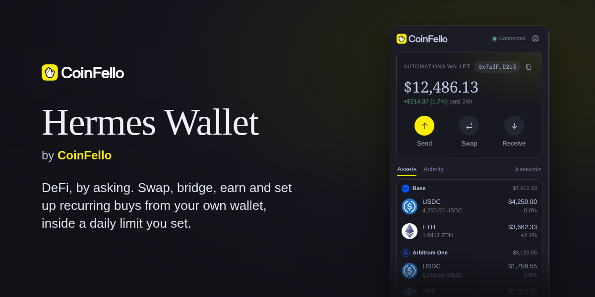
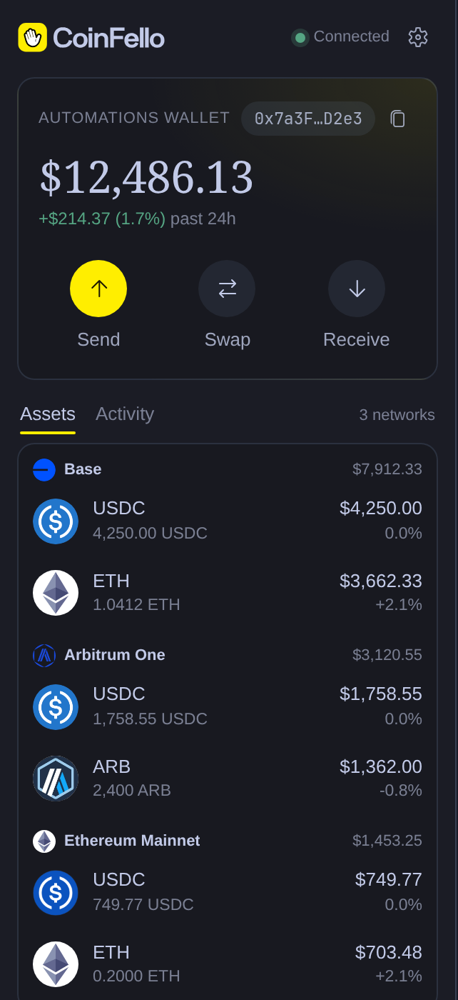
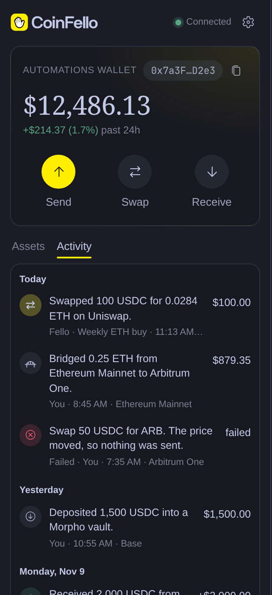
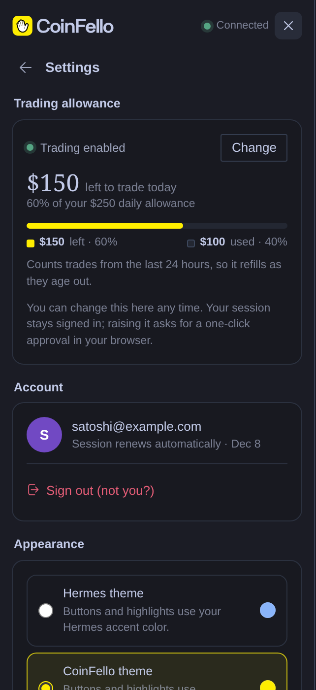

# Hermes Wallet by CoinFello



A Hermes Agent plugin that connects the agent to [CoinFello](https://coinfello.com)
through the CoinFello MCP server: sign in once, and the agent gets fast reads
over your automation wallet (balances, positions, LP ranges, open orders,
activity, prices, yields, swap/bridge quotes) plus **Fello**, CoinFello's DeFi
agent, which can execute on-chain actions for you.

Sign-in is Hermes's own OAuth: CoinFello is declared under `oauth:` in
`plugin.yaml`, you run `hermes auth add coinfello:coinfello` once, and Hermes
stores, refreshes and attaches the grant. The plugin never sees a token.

Includes a desktop pane: the sign-in command to copy, the automations wallet
(copy + QR to fund it), balances per network shaped like the CoinFello
Portfolio view, and CoinFello's MCP App cards (portfolio, quotes,
automations, yields, ...) when the agent shows one.

## What you get

**20 agent tools** (toolset `coinfello`):

| Tool | What it does |
|---|---|
| `coinfello_status` | Connection state, wallet (funding) address, expiry |
| `coinfello_connect` | Tells you the one command to sign in (`hermes auth add coinfello:coinfello`); the agent cannot run it |
| `coinfello_disconnect` | Revoke the session now |
| `coinfello_chat` | Ask Fello to do something; it stages fund-moving actions for `coinfello_execute` (each message needs your approval) |
| `coinfello_job_status` | Poll a running Fello turn (its reply lists staged actions too) |
| `coinfello_balances` / `_positions` / `_lp_positions` / `_open_orders` / `_activity` | Wallet reads |
| `coinfello_quote` | Swap/bridge quote, for comparing (executes nothing, not executable by reference) |
| `coinfello_prepare_swap` / `coinfello_prepare_send` | Validate, price and hold a trade as a 2-minute single-use intent (executes nothing) |
| `coinfello_execute` | Run a prepared intent or a staged Fello action, only after you approve its summary in Hermes |
| `coinfello_transfer_status` | What a swap/bridge actually delivered: completed, wrong_token, refunded, failed |
| `coinfello_yields` / `_prices` | Market reads |
| `coinfello_show_card` | Show a CoinFello card: drawn in the desktop pane; other surfaces get its text |
| `coinfello_set_daily_limit` / `_limit_status` | Lower the daily limit, or ask the human to approve a raise |

**Desktop pane** (desktop half of the same package):





Screenshots use demo data.

- **Sign in**: shows the `hermes auth add coinfello:coinfello` command with a
  copy button, and picks the sign-in up on its own once you have approved it
  in your browser.
- **Automations wallet**: address with copy button and a scannable QR to
  fund it (same address on every EVM network).
- **Portfolio**: total value with its 24h move, balances grouped per network
  with token logos, using the same rules as the web Portfolio view
  (`coinfello_portfolio.py` names the web function each rule is ported from).
- **Full portfolio** and **Strategies** open CoinFello's own views in Hermes
  tabs; **Activity** lists every transaction, failed ones included.
- **Settings**: the agent's daily spending limit, your account and sign-out,
  and appearance.
- **Cards** the agent shows appear at the top of the pane (see below).
- Statusbar connection chip.

## Install

From the Hermes plugin catalog (once the listing is merged):

```bash
hermes plugins install coinfello
```

From source:

```bash
git clone https://github.com/CoinFello/hermes-wallet.git
cd hermes-wallet
./install.sh                       # copies the plugin into ~/.hermes/plugins/coinfello
hermes plugins enable coinfello    # admits it AND installs its Python deps (segno)
```

Restart Hermes. The agent tools appear as `coinfello_*`. The desktop pane
appears after **Reload desktop plugins** in the command palette (Ctrl+K, or
Cmd+K on macOS); the desktop half is opt-in and is listed under
Capabilities → Plugins.

### Sign in

```bash
# CoinFello's public OAuth client id for this plugin (not a secret; PKCE protects the code)
echo 'COINFELLO_OAUTH_CLIENT_ID=coinfello-hermes' >> "$(hermes config env-path)"
hermes auth add coinfello:coinfello
```

`hermes auth add` opens CoinFello in your browser. Sign in, choose what the
agent may do (read only, or trade up to a daily limit), and approve. Hermes
then keeps the grant: it refreshes it before it expires, sends it only to
`app.coinfello.com`, and the plugin's requests go through Hermes's
`credentialed_provider_request`. Check it with
`hermes auth status coinfello:coinfello`. Hermes refuses `hermes auth add` from
an agent session, the messaging gateway or cron, so the agent can only tell you
the command (`coinfello_connect`), never run it.

The sign-in is an OAuth 2.1 authorization-code grant with PKCE against
CoinFello (`/api/auth/mcp/authorize`, `/api/auth/mcp/token`). Access tokens
last an hour; refresh tokens are single-use, and a grant ends 180 days after
you approve it.

## The pane

- **Header:** the CoinFello logo (wordmark follows your theme's text colour),
  connection state, and a **Settings** gear.
- **Home:** the automations wallet card (address + copy, portfolio total and
  24h change, Send / Swap / Earn / Receive, where Receive shows the funding
  QR, and **Full portfolio** / **Strategies** right under them). Below that,
  assets grouped by network and the wallet's activity.
  **Full portfolio** and **Strategies** open CoinFello's own views in Hermes
  tabs (main area) when the server offers them (`create_embed_token` with
  scope `portfolio` / `strategies`, both read-only, so read-only sessions can
  open them): they always show this plugin's account, with no browser,
  cookies or wallet extension involved. Strategies is for browsing the
  catalog, a strategy's details and what is running; to start one, ask the
  agent. On servers without a view, its pill says "Coming to Hermes soon"
  and opens nothing: the browser is not a fallback, because the web app
  reconnects extension wallets, which can sign in as a different account.
  A read-only session or a pending allowance change shows one notice that
  opens Settings.
- **Settings:** the trading allowance (daily limit, what's left in the last
  24 hours, change it without signing in again), the account and sign-out,
  **Appearance** (CoinFello colors), and the server in use.

The styling is one stylesheet scoped to `.cf`, injected at register and
removed on dispose. Surfaces, text, borders, fonts and gain/loss colours come
from the active Hermes theme (`--ui-*`, `--font-*`, `--ui-green`/`--ui-red`).
Buttons and highlights use the theme's accent (`--dt-primary`, the colour of
Hermes' own primary buttons) by default; **Settings > Appearance > CoinFello
colors** switches them to CoinFello's yellow (saved per app with
`ctx.storage`). CoinFello also contributes the logo, serif portfolio figures,
round token icons and rounded cards.

## Signing out

`coinfello_disconnect` (or **Sign out** in Settings) asks CoinFello to revoke
the grant, which ends it at once for every copy of its tokens. Run
`hermes auth logout coinfello:coinfello` to also remove it from Hermes. Turning
off the Automation Wallet in the CoinFello app ends it too.

## Trading from the agent

1. `coinfello_prepare_swap` (or `_send`) asks the server to quote and validate
   the trade (balance, recipient, gas on the source chain) and to hold it as a
   single-use intent for two minutes. Nothing moves.
2. `coinfello_execute` runs it. Before it does, the plugin's `pre_tool_call`
   hook puts it through Hermes' approval prompt, showing the **server's**
   summary of that intent (cached at prepare time, never text the model
   wrote), e.g. *Bridge 0.004186 ETH on Ethereum Mainnet to at least 113.25
   POL on Polygon via layerswap*. Deny, and nothing is sent. The rule key is
   per intent, so an "always" answer never covers another trade.
3. The server executes exactly the prepared arguments: a price below the
   approved minimum (`price_moved`) or a different bridge than the approved
   one (`route_changed`) is refused before anything is broadcast.
4. A bridge's success only confirms the source chain. `coinfello_transfer_status`
   reads the bridge's delivery status and says what arrived: `wrong_token` (e.g. Across
   delivering WETH instead of native POL) and `refunded` are failures to
   report, not to repair with another trade.

`coinfello_chat` gets the same prompt for every message.

### Actions Fello stages

Everything else (staking and yield, Hyperliquid perps, Polymarket, LP
positions, hedges, pausing or cancelling an automation) goes through Fello.
On servers that offer it, `coinfello_chat` asks Fello to
**stage** those actions instead of running them:

1. The reply (from `coinfello_chat`, or `coinfello_job_status` for a long
   turn) lists `staged_actions`: an `intent_id`, the **server's** summary
   (built from the arguments, never from Fello's prose), its `effect`
   (`spend`, `returns`, `automation` or `other`), `usd` and `expires_at`
   (ten minutes). Nothing has run.
2. The plugin registers each one with that summary. The agent shows you the
   summaries and calls `coinfello_execute` with an `intent_id` you agreed to.
   Hermes' approval prompt shows the server's summary with what it costs,
   e.g. *Stake 0.5 ETH on Lido. Staged by Fello (enter_staking_yield). Spends
   ~$1,234.56, charged to the daily limit.* One rule key per intent, so an
   "always" answer never covers another action.
3. The result says which tool ran, its transaction hashes, and whether the
   outcome is unknown (may have gone through: never retry) or the wallet
   needs its automation permission. The agent then tells Fello the result on
   the same `chat_id` so it can continue a multi-step plan.

A spend CoinFello could not price (`usd: null`) is blocked before any prompt:
the server would refuse it. An `intent_id` that did not come from this Hermes
(a prepare or a staged reply) is refused outright, as before. Older servers
never see the `stage_actions` flag.

Approvals follow your Hermes settings: `--yolo` or **Approvals: off** skip
the prompt for these tools too, and non-interactive runs (cron, `-q`) are
refused unless you configured them to auto-approve.

Servers without `prepare_swap` (older CoinFello servers) cannot
prepare trades; `coinfello_transfer_status` then reads the bridge status
directly.

## Cards (MCP Apps)

CoinFello's MCP server ships its views as MCP App cards: `show_<card>_card`
tools whose `_meta.ui.resourceUri` names a `ui://coinfello/...` HTML
document. The agent shows one with `coinfello_show_card` (`portfolio`,
`status`, `quote`, `automations`, `needs_you`, `error`, `fund`, `yield`,
`lp_ranges`, `perp`, `send`, `dca`, `earn_deposit`, `spend_limit`; the
sign-in card is left out, the pane has its own sign-in).

1. The plugin calls the server's card tool with the stored session, sending
   only the arguments the tool's schema declares, never a session token.
2. On **Hermes desktop** (`ctx.session_surface() == "desktop"`) the raw
   result becomes a card record (memory and `<hermes home>/coinfello/cards/`,
   0600, 24 hours), the pane is told (`plugin.coinfello.card.shown`), and the
   agent is told the card is in the pane. On every other surface (Telegram,
   CLI, ...) the agent gets the card's full text and no card is stored.
3. The pane fetches `/cards/{id}`: the card's HTML with a CSP meta tag and
   the theme injected, as a `data:` URL, plus the tool input and result. It
   mounts it in a `SandboxedFrame` (`allow-scripts` only: opaque origin, no
   storage, no popups) and answers the card's MCP Apps bridge.

What a card may call, checked in the pane and again in Python:

| Card | Relayed | Needs the human's Confirm in the pane |
|---|---|---|
| every card | its own `show_*_card` (refresh), `whoami` | |
| quote | `prepare_swap`, `prepare_send`, `show_status_card` | `execute_intent` |
| send / dca | its `prepare_*`, `show_status_card` | `execute_intent` |
| spend_limit | `prepare_spend_limit` | `execute_intent` |
| yield | `show_earn_deposit_card`, `prepare_earn_deposit`, `show_status_card` | `execute_intent` |
| earn_deposit | `prepare_earn_deposit`, `show_yield_card`, `show_status_card` | `execute_intent` |
| automations | `pause_automation` | `cancel_automation` |
| error | its Retry tool, if on the server's retryable list (reads and quotes) | |

The yield and earn deposit cards are one flow in one frame: coinfello-web
builds both documents with both renderers, so a yield row's **Deposit**
calls `show_earn_deposit_card({yield_id})` and draws the result's
`structuredContent` in place, and the deposit card's **Browse yields** does
the same with `show_yield_card`. The pane relays these like any
`tools/call` and hands the raw result back; it does not mount a second card
or open the Earn view. The frame keeps the record and allowlist of the card
that was shown, which is why each one lists the other's show tool and the
deposit's prepare and confirm.

`show_status_card` (a read) is relayed from the cards that can end in
"outcome unknown" after `execute_intent`, for their **Check status** button.

`execute_intent` runs only for an intent this card produced and Hermes
prepared (the server's summary, kept with the card record, is what the
confirmation shows), once and before it expires.
`cancel_automation` runs only for an automation the card listed. Sign-out,
Fello, sign-in, embed tokens and daily-limit changes are
never relayed, nor is anything not in the table. Credential-like keys are
stripped from arguments and results in both directions.

The card's CSP: `default-src 'none'; script-src 'unsafe-inline'; style-src
'unsafe-inline' <resourceDomains>; font-src <resourceDomains>; img-src data:;
connect-src 'none'; frame-src 'none'; base-uri 'none'; form-action 'none'`.

Cards need Hermes 0.22.3 or newer (`ctx.session_surface`); on older Hermes
the tool returns the card's text everywhere. The plugin does not advertise
the MCP Apps extension to the server, so card tools always answer with
their full text plus `structuredContent`, on every surface.

### Swap, Earn and Full portfolio: CoinFello's own UI in Hermes

The pane's **Swap** and **Earn** buttons host coinfello-web's `/embed/swap`
and `/embed/earn` (the app's real components) in a `SandboxedFrame`, and
**Full portfolio** docks `/embed/portfolio` in a main-area tab. One host
serves all three (`desktop/plugin.js`, the `embed-host` section): the frame
loads `<app><path>?theme=dark|light`, says `coinfello:embed-ready`, and gets
a 15-minute token minted for its scope (`POST /embed-token {scope}` ->
`create_embed_token`, never the session token) with a per-mount nonce. A
later token request must echo the nonce, and one within a minute of the
last token stops instead of looping on a dead session. Messages from any
window but the host's own frame are ignored; heights are clamped to
240-1200px.

- **Links**: the sandbox has no `allow-popups`, so an embed asks the pane
  with `coinfello:open-url`; only allowlisted https block explorers open, at
  most once a second. An embed that can do this says so in `embed-ready`
  (`features: ['open-url']`), and its own View button is the only one.
  For older embeds the pane adds one fallback View under the frame.
- **Results** arrive as `coinfello:swap-result` / `coinfello:earn-result`
  (the portfolio view has none). An Earn result says "nothing was sent" only
  for a cancel or failure with no transaction, and anything uncertain asks
  the person to check it.
- **Scopes**: swap needs trading access; Earn is always asked of the server
  (it may mint for browsing); portfolio is minted with a plain read call,
  only when the server's `scope` enum lists `portfolio`.

- **Earn preselects**: `&opportunity=<yield id>`, or `&token=<SYMBOL>&chain_id=<n>`,
  validated and percent-encoded by `coinfello_earn.frame_query`.
- **From the agent**: `coinfello_show_card` with `card="earn_deposit"` on
  Hermes desktop opens the Earn view (with any preselect from its
  arguments) instead of the typed-yield-id card, and calls no CoinFello tool.
  Other surfaces keep the card's text. This reuses `coinfello_show_card`
  rather than adding a tool: it is where the agent already goes to deposit,
  and it keeps the desktop-or-text rule in one place. A yield card's Deposit
  inside the pane is not this path: it stays in the card (see the table above).
- **Read-only sessions** may open Earn: the server decides whether to mint a
  token for browsing, and a refusal is shown in plain words.
- **Older servers** (no `scope` on `create_embed_token`, or one without
  `earn`): no Earn button, a one-line note, and `earn_deposit` on desktop
  shows the `yield` card when it has a token to show (otherwise the deposit
  card, as before). The agent's note says whether its rows offer Deposit.

## Security notes

- The plugin stores no credential and reads none: no `.env`, no `auth.json`.
  Hermes holds the CoinFello OAuth grant and attaches it to the plugin's
  requests, only for `app.coinfello.com`. The grant can move funds within the
  daily limit you chose; revoke it with `coinfello_disconnect`, or in the
  CoinFello app (Automation Wallet), which ends it immediately.
- Stored by the plugin: non-secret state in Hermes's plugin store
  (`plugin-data/coinfello/state.json`): whether the last request was signed
  in, the wallet address, the access level and a pending limit change.
- **Daily spending limit**: a grant that can trade has one, and CoinFello's
  server enforces it on every trade, whatever the agent was told. Grants can
  also be read-only. The plugin and the agent can only lower the limit; a
  raise returns a link you approve in your browser, and you stay signed in.
- `coinfello_chat` asks Fello to read and plan. On current CoinFello servers
  (coinfello-web#1176 and later) a Fello turn over MCP cannot move funds: it
  tells the agent which trade to prepare, and the trade then goes through
  `prepare_*` and `coinfello_execute`. Hermes still asks you to approve each
  message, as a second guard for older servers where Fello could act.
- Unattended runs (cron, the messaging gateway): sign-in never waits on a
  person; without a grant every tool fails at once with the sign-in command.
  `coinfello_execute` and `coinfello_chat` need Hermes's approval prompt.
- `coinfello_execute` runs only intents this Hermes process prepared, once,
  after you approve the server's summary in Hermes.
- Fast reads (`get_*`) are read-only.

## Privacy and usage data

The plugin sends no telemetry: no analytics SDK, no install id, no heartbeat
or other request made only to be counted.

It talks to CoinFello's MCP server (`https://app.coinfello.com/api/mcp`), and
while the desktop pane is open it refreshes status and balances every 30-60
seconds (every 5 seconds while it waits for you to sign in). Background work:
the pane's polling while open, and one background request to revoke the
grant when you sign out from the pane. Every request names the client in its `User-Agent`
(`coinfello-hermes-plugin/<version> (Hermes; ...)`). **CoinFello records usage
of its service on its servers**, under the
[CoinFello privacy policy](https://coinfello.com/privacy-policy): at most once a day
per signed-in session, an activity event with your CoinFello account id, the
session's automation wallet address, the session id, and the client name and
version. That is how CoinFello counts daily and monthly active users and
installs. Signing out ends the grant; the plugin keeps no other identifier.

Other network calls: token and network icons from MetaMask's icon service
(`static.cx.metamask.io`) and CoinFello's site, and block explorers you
choose to open. CoinFello's
cards (see Cards) load their fonts from Google Fonts (`fonts.googleapis.com`,
`fonts.gstatic.com`), the only outside hosts a card's CSP allows, so Google
sees your IP address and the font request when a card is drawn; cards have no
other network access.

## Development

```bash
uv run --no-project --with pytest --with fastapi --with httpx --with 'segno>=1.6,<2' pytest tests/
node --test tests/card_bridge.test.mjs   # the pane's card bridge (pytest runs it too when node is installed)
node --test tests/amount.test.mjs        # the pane's amount normalizer (likewise)
node --test tests/embed_host.test.mjs    # the pane's swap/Earn/portfolio embed host (likewise)
```

The test suite runs a local mock of the MCP streamable-HTTP transport, with
no network or real credentials involved.

### Layout

```
├── plugin.yaml            agent-plugin manifest (provides_tools)
├── pyproject.toml         Python deps (segno), installed by Hermes plugin admission
├── __init__.py            register(ctx): registers the agent tools and the approval hook
├── coinfello_mcp.py       stdlib MCP streamable-HTTP client
├── coinfello_state.py     endpoint + non-secret pane state (no credentials)
├── coinfello_core.py      service layer (sign-in steps, reads, status)
├── coinfello_portfolio.py pane portfolio model, ported from the web Portfolio view
├── coinfello_tools.py     tool schemas + handlers
├── coinfello_trades.py    prepare/execute, the approval hook, transfer status
├── coinfello_cards.py     MCP App cards: show, card records, CSP, bridge allowlist
├── coinfello_earn.py      the Earn view: preselects, frame query, the agent's open request
├── dashboard/             web/desktop backend: FastAPI router at /api/plugins/coinfello/
├── desktop/plugin.js      desktop pane + statusbar chip + card frames
└── tests/                 mock-MCP test suite
```

### Roadmap

- **Wide cards**: cards target ~480px and the pane is ~320px, so a card that
  overflows is scaled down. Opening a card in the main workspace
  (`host.openWorkspace`) would give it full width.

- **Tier 2**: MetaMask mobile via WalletConnect (QR pairing; transactions
  approved on-device).
- **Tier 3**: MetaMask browser extension embedded in the Hermes desktop app
  (extension-host pane; feasibility spike required).
